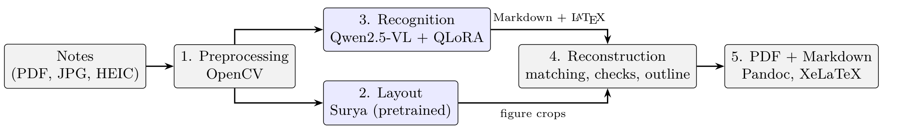

# InTra-IE643 — Handwritten lecture notes to structured PDF

IE 643 (Deep Learning: Theory and Practice), July–Dec 2026 course project, team **Intra**
(Ishaan Mane, Akshat Verma).

Handwritten lecture notes (digital stylus notes, scans or phone photos) go in; a searchable, structured PDF and an
editable Markdown file come out. Text and equations are read by **Qwen2.5-VL-7B fine-tuned with
QLoRA**, drawings are located by **Surya** and cropped from the original page, and a deterministic
renderer builds the PDF without adding any content.



## Results (test set, 76 pages)

| | zero-shot Qwen2.5-VL-7B | **fine-tuned (ours)** |
|---|---|---|
| Corpus character error rate ↓ | 0.915 | **0.332** |
| Normalised edit distance ↓ | 0.596 | **0.311** |
| Token F1 ↑ | 0.623 | **0.855** |
| Equation F1 (normalised LaTeX) ↑ | 0.143 | **0.338** |

Fine-tuning improves 74 of 76 test pages. Reconstruction keeps all 529 content blocks of the test
documents and builds all 9 PDFs; 84.5% of placed figures show the right drawing (manual grading).
Full tables: [`results/recognition_experiments.md`](results/recognition_experiments.md),
per-stage findings: [`findings/`](findings/).

## Trained model

LoRA adapter (172 MB) for `Qwen/Qwen2.5-VL-7B-Instruct`:
**[releases/model-final-clean](https://github.com/aksh10-at/InTra-IE643/releases/tag/model-final-clean)**
(SHA-256 `bf8a4c5f1ae3adc633ace079094e8d3df2dea42a62a0ca91c7119c7a30a3bf7a`). How it was trained
and how to load it: [`03_recognition/MODEL_README.md`](03_recognition/MODEL_README.md).

## Repository layout

| Folder | Stage |
|---|---|
| [`00_dataset/`](00_dataset/) | Build splits and training files from labels; dataset checks |
| [`01_preprocessing/`](01_preprocessing/) | OpenCV page clean-up (`experiments/`: Sauvola binarisation) |
| [`02_layout/`](02_layout/) | Surya v2 layout detection (pretrained) |
| [`03_recognition/`](03_recognition/) | Qwen2.5-VL QLoRA fine-tuning and prediction |
| [`04_reconstruction/`](04_reconstruction/) | Deterministic renderer, checked outline, PDF style |
| [`05_evaluation/`](05_evaluation/) | Metrics, ablations, layout counts, figure grading |
| [`06_interface/`](06_interface/) | Notes2PDF web interface |
| [`data/`](data/) | 410 page images and labels, splits |
| [`preds/`](preds/), [`results/`](results/), [`logs/`](logs/) | Predictions, scores, figures, training logs |
| [`findings/`](findings/), [`docs/`](docs/) | What each stage found; notes and development record |

## Run the pipeline (GPU machine, from the repo root)

```bash
pip install -r requirements.txt -r 03_recognition/requirements-train.txt   # PyTorch for CUDA first
python3 00_dataset/build_dataset.py && python3 00_dataset/check_dataset.py
python3 01_preprocessing/batch_preprocess.py --workers 8 --force
python3 02_layout/run_layout.py                    # needs the Surya/vLLM environments, see 02_layout/README.md
python3 03_recognition/finetune_qwen25vl.py --test # trains and scores (about 1.5 h on a 16 GB GPU)
bash 04_reconstruction/run_reconstruction.sh       # PDFs for validation and test
python3 05_evaluation/evaluate.py --pred preds/final_clean_test --split data/test.jsonl --full
```

Convert your own notes with the trained adapter:

```bash
python3 06_interface/pipeline.py my_notes.pdf --out out/my_notes --adapter path/to/final_adapter
python3 06_interface/manage.py start --tunnel cloudflare     # web interface
```

## Data

IE643 class scribes (digital stylus ink on a dark background), MLT notes (digital stylus ink on white), an IE802 notebook and 20 pages of the
[HumynLabs handwritten CS notes](https://huggingface.co/datasets/HumynLabs/Handwritten-Computer-Science-Notes-Dataset).
Split by lecture/week/notebook into 303 / 31 / 76 pages. Details: [`data/README.md`](data/README.md),
[`findings/00_dataset.md`](findings/00_dataset.md).
