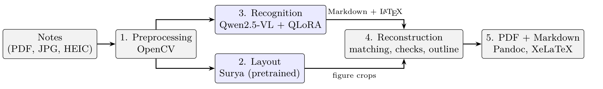

# InTra-IE643 — Handwritten lecture notes to structured PDF

IE 643 (Deep Learning: Theory and Practice), July–Dec 2026 course project, team **InTra**
(Ishaan Mane, Akshat Verma).

**Novelty phase (final version):** [poster](novelty/poster/InTra_IE643_CourseProject_Poster.pdf) ·
[2-page report](novelty/report/InTra_IE643_NoveltyAssessment_report.pdf) ·
[demo video](https://drive.google.com/file/d/1GM-y0Mdh6S_8vNPYg1NoYMK0SRUTaTso/view?usp=sharing) ·
step log [`novelty/NOTES.md`](novelty/NOTES.md).

Handwritten lecture notes (digital stylus notes, scans or phone photos) go in; a searchable, structured PDF and an
editable Markdown file come out. Text and equations are read by **Qwen2.5-VL-7B fine-tuned with
QLoRA**, drawings are located by **Surya** and cropped from the original page, and a deterministic
renderer builds the PDF without adding any content. In the novelty phase the figures are placed by
**Method B, "Surya decides where, Qwen decides which"** (see below).



## Results (test set, 76 pages)

| | zero-shot Qwen2.5-VL-7B | **fine-tuned (ours)** |
|---|---|---|
| Corpus character error rate ↓ | 0.915 | **0.332** |
| Normalised edit distance ↓ | 0.596 | **0.311** |
| Token F1 ↑ | 0.623 | **0.855** |
| Equation F1 (normalised LaTeX) ↑ | 0.143 | **0.338** |

Fine-tuning improves 74 of 76 test pages. Reconstruction keeps all 529 content blocks of the test
documents and builds all 9 PDFs.
Full tables: [`results/recognition_experiments.md`](results/recognition_experiments.md),
per-stage findings: [`findings/`](findings/).

## Novelty phase: getting the figures right

The intensive assessment showed that figures on dense notebook pages (IE802) were often the wrong
drawing. We drew ground-truth boxes for 24 IE802 val/test figures and traced every error to the
stage that caused it: most came from pairing descriptions with Surya boxes by reading order.

- **Method B.** The base Qwen (adapter off) gives a rough box for each `[Diagram: ...]` line, and the
  Hungarian algorithm pairs descriptions with Surya boxes by overlap. Reading order no longer matters.
- **Surya 2.5** instead of Surya 2 (figure precision 0.73 → 0.83 on all 410 pages).
- **Shared-box re-grounding** when two descriptions get the same box, and a **completeness check**
  that only enlarges a crop when Qwen says more of the sketch is shown.
- **Recovered drawings** that Qwen never described, **crop cleaning** and a cleaner PDF layout.
- **Textbook footnotes**: one cited sentence per section from *Dive into Deep Learning* (BM25).

| IE802 val + test (23 descriptions with a GT drawing) | right drawing | box IoU ≥ 0.5 | localisation error ↓ |
|---|---|---|---|
| A: reading order (old) | 15 | 10 | 0.58 |
| B: Qwen grounding + Hungarian | 21 | 14 | 0.42 |
| B + Surya 2.5 + shared-box fix + completeness check (final) | **23** | **19** | **0.30** |

Blind human grade of the placed figures: Figure Error Score 0.42 → 0.17. Every later change was
checked blind, side by side. Details, negative results (maths second readers, notation retrain) and
all scripts: [`novelty/`](novelty/), step log [`novelty/NOTES.md`](novelty/NOTES.md).

## Trained model

LoRA adapter (172 MB) for `Qwen/Qwen2.5-VL-7B-Instruct`:
**[releases/model-final-clean](https://github.com/aksh10-at/InTra-IE643/releases/tag/model-final-clean)**
(SHA-256 `bf8a4c5f1ae3adc633ace079094e8d3df2dea42a62a0ca91c7119c7a30a3bf7a`). How it was trained
and how to load it: [`03_recognition/MODEL_README.md`](03_recognition/MODEL_README.md).

## Repository layout

| Folder | Stage |
|---|---|
| [`00_dataset/`](00_dataset/) | Build splits and training files from labels; dataset checks |
| [`01_preprocessing/`](01_preprocessing/) | OpenCV page clean-up (`experiments/`: Sauvola binarisation) |
| [`02_layout/`](02_layout/) | Surya 2 layout detection (pretrained); Surya 2.5 in `novelty/surya25.py` |
| [`03_recognition/`](03_recognition/) | Qwen2.5-VL QLoRA fine-tuning and prediction |
| [`04_reconstruction/`](04_reconstruction/) | Deterministic renderer, checked outline, PDF style |
| [`05_evaluation/`](05_evaluation/) | Metrics, ablations, layout counts, figure grading |
| [`06_interface/`](06_interface/) | Notes2PDF web interface (first version) |
| [`06_interface_v2/`](06_interface_v2/) | Notes2PDF v2: the full novelty pipeline (used in the demo) |
| [`novelty/`](novelty/) | Novelty phase: figure diagnosis, Method B, Surya 2.5, crop fixes, maths study, footnotes, poster and report |
| [`data/`](data/) | 410 page images and labels, splits |
| [`preds/`](preds/), [`results/`](results/), [`logs/`](logs/) | Predictions, scores, figures, training logs |
| [`findings/`](findings/), [`docs/`](docs/) | What each stage found; notes and development record |

## Run the pipeline (GPU machine, from the repo root)

```bash
pip install -r requirements.txt -r 03_recognition/requirements-train.txt   # PyTorch for CUDA first
python3 00_dataset/build_dataset.py && python3 00_dataset/check_dataset.py
python3 01_preprocessing/batch_preprocess.py --workers 8 --force
python3 02_layout/run_layout.py                    # needs the Surya/vLLM environments, see 02_layout/README.md
python3 03_recognition/finetune_qwen25vl.py --test # trains and scores (about 1.5 h on a 16 GB GPU)
bash 04_reconstruction/run_reconstruction.sh       # PDFs for validation and test
python3 05_evaluation/evaluate.py --pred preds/final_clean_test --split data/test.jsonl --full
```

Convert your own notes with the trained adapter and the full novelty pipeline (v2):

```bash
python3 06_interface_v2/pipeline.py my_notes.pdf --out out/my_notes --adapter path/to/final_adapter
python3 06_interface_v2/manage.py start --tunnel cloudflare  # web interface (or: bash START_INTERFACE_V2.sh)
```

The first version is still available as `06_interface/pipeline.py` and `06_interface/manage.py`.

## Data

IE643 class scribes (digital stylus ink on a dark background), MLT notes (digital stylus ink on white), an IE802 notebook and 20 pages of the
[HumynLabs handwritten CS notes](https://huggingface.co/datasets/HumynLabs/Handwritten-Computer-Science-Notes-Dataset).
Split by lecture/week/notebook into 303 / 31 / 76 pages. Details: [`data/README.md`](data/README.md),
[`findings/00_dataset.md`](findings/00_dataset.md).
